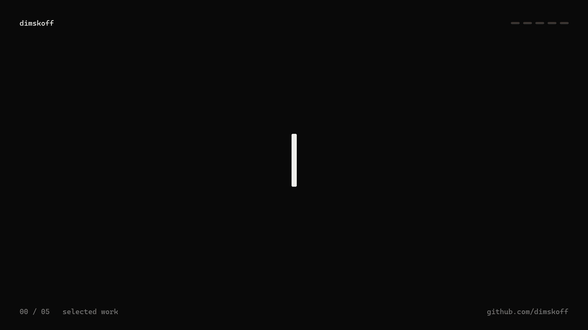
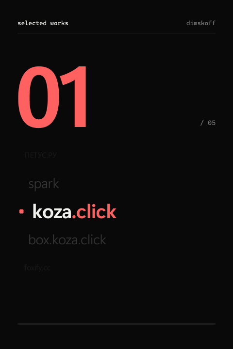



  
  

 

### Selected work

`01` &nbsp;**[koza.click](https://koza.click)** · [repo](https://github.com/dimskoff/koza) 
Short links, zero strings. No account, no tracking. Self-hostable — one JSON file, `docker compose up`.

`02` &nbsp;**[box.koza.click](https://box.koza.click)** 
Files that travel straight. Peer-to-peer transfer in the browser — nothing stored on the server.

`03` &nbsp;**[foxify.cc](https://foxify.cc)** 
VPN service. Traffic encryption and a stable connection — at home and on mobile. Telegram mini-app.

`04` &nbsp;**ПЕТУС.РУ** 
Social network: feed, messages, «Кадры», music and a dictionary of absurd phrases.

`05` &nbsp;**[Spark](https://github.com/AcelateOrg/Spark)** 
A code-first game engine built for AI-written games. Rust + wgpu core, game code in Luau, native executables.

<b>Minecraft / OpenComputers</b>

 

- **[Computronics-Rebooted](https://github.com/dimskoff/Computronics-Rebooted)** — OpenComputers Rebooted addon mod · Java
- **[littletiles-oc-addon](https://github.com/dimskoff/littletiles-oc-addon)** — Signal Converter block: LittleTiles signals → OC Lua scripts · Java
- **[BankX](https://github.com/dimskoff/BankX)** — banking server core for an OpenComputers ATM setup · Go

 

### Stack

  

 

koza.click · foxify.cc · github.com/dimskoff

