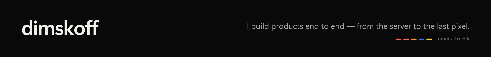
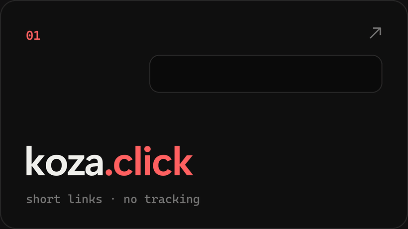
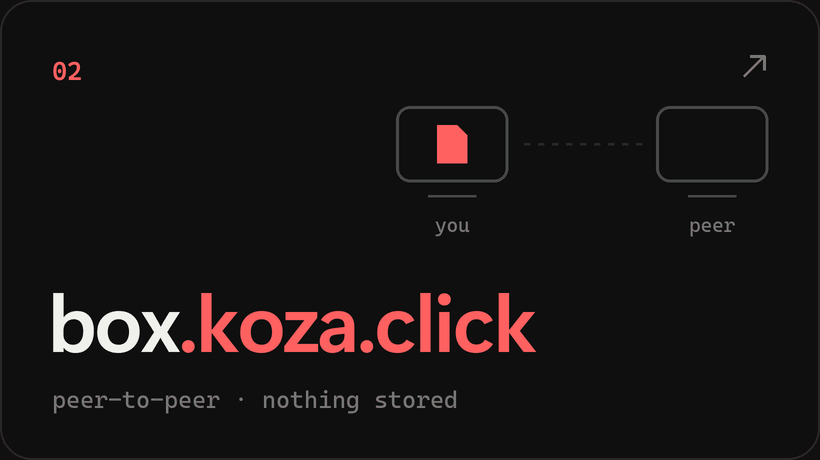
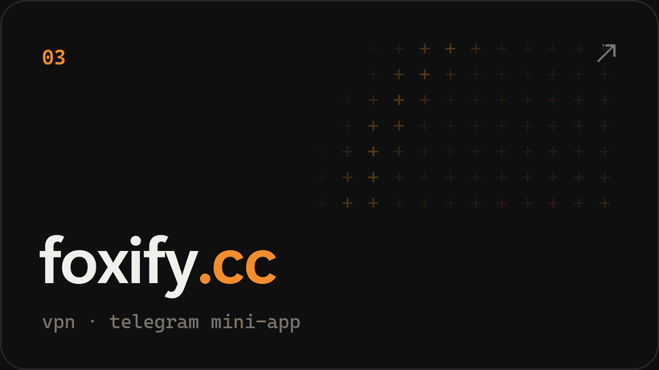
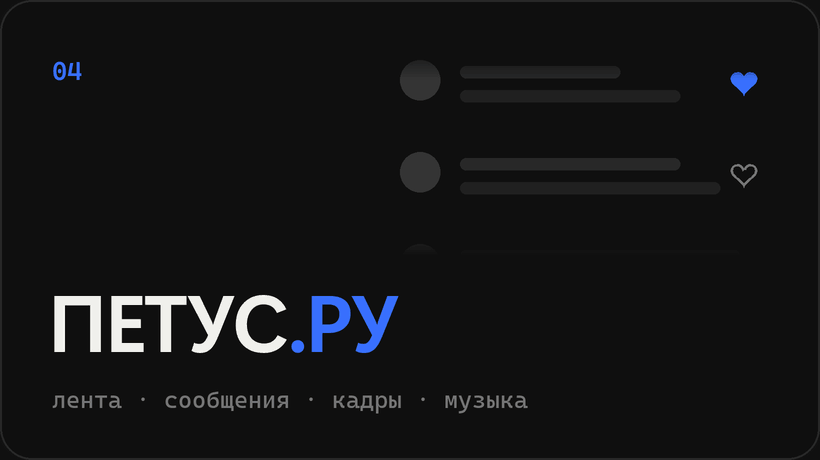
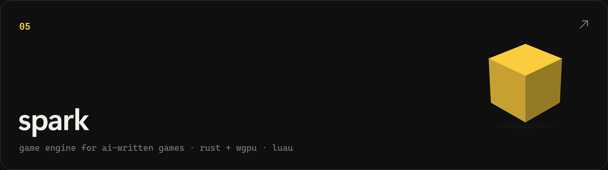

  
  

 

### Selected work

  
  
  
  
  

koza is open source — <a href="https://github.com/dimskoff/koza">github.com/dimskoff/koza</a> · one JSON file, <code>docker compose up</code>.

<b>Minecraft / OpenComputers</b>

 

- **[Computronics-Rebooted](https://github.com/dimskoff/Computronics-Rebooted)** — OpenComputers Rebooted addon mod · Java
- **[littletiles-oc-addon](https://github.com/dimskoff/littletiles-oc-addon)** — Signal Converter block: LittleTiles signals → OC Lua scripts · Java
- **[BankX](https://github.com/dimskoff/BankX)** — banking server core for an OpenComputers ATM setup · Go

 

### Stack

  

 

koza.click · foxify.cc · github.com/dimskoff

